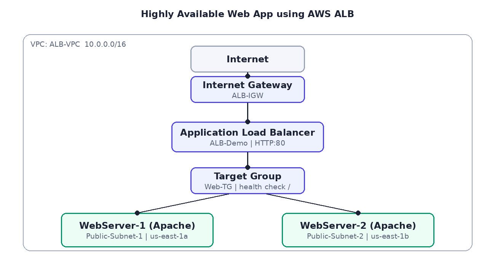
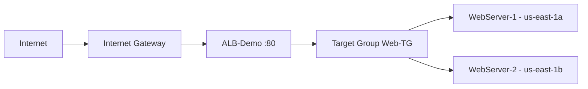

# Highly Available Web Application using AWS ALB

A web application deployed in a **custom VPC** across **two Availability Zones**. Two Apache web servers sit behind an **Application Load Balancer**; health checks automatically stop sending traffic to a failed server.

## Network design
| Component | Configuration |
|---|---|
| VPC | `ALB-VPC` - 10.0.0.0/16 |
| Public Subnet 1 | 10.0.1.0/24 - us-east-1a (WebServer-1) |
| Public Subnet 2 | 10.0.2.0/24 - us-east-1b (WebServer-2) |
| Internet Gateway | `ALB-IGW`, route `0.0.0.0/0` via `Public-RT` |
| Target Group | `Web-TG` - HTTP:80, health check path `/` |
| Load Balancer | `ALB-Demo` - internet-facing, HTTP:80 |

## Security groups
- `ALB-SG`: HTTP 80 from anywhere
- `WebServer-SG`: HTTP 80 **only from ALB-SG**, SSH 22 from my IP only

## Tech stack
Amazon VPC | EC2 (Amazon Linux 2023) | Apache (httpd) | Application Load Balancer | Target Groups | Security Groups | Internet Gateway | Route Tables

## Testing and results
| Test | Result |
|---|---|
| Requests via ALB DNS name | Distributed between Server 1 and Server 2 |
| Health checks | Both targets healthy |
| **Failure test** - stop WebServer-1 | ALB marked it unhealthy and kept serving from Server 2 |

## Repository contents
- `scripts/` - EC2 user-data scripts for both web servers
- `images/architecture.png` - architecture diagram
- `report/` - full project report with step-by-step procedure

## Future improvements
Private subnets for EC2, HTTPS with ACM, Auto Scaling (described in the report as an optional extension), CloudWatch alarms, Route 53 domain, Terraform/CloudFormation.

## Author
**Atharva Vadage** - [GitHub](https://github.com/Atharva72218)
